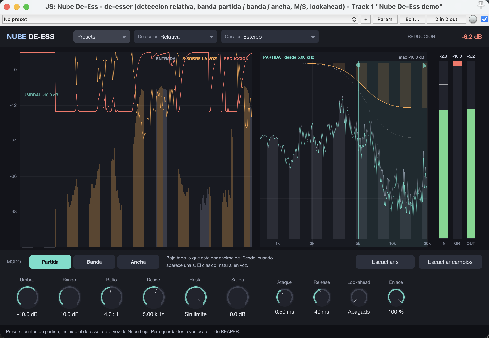

<!-- en -->
# Nube De-Ess

A free de-esser for [REAPER](https://www.reaper.fm), written as a JSFX (macOS / Windows / Linux), part of the
[Nube plugins](https://github.com/KevinMeneses/nube-plugins).



Relative detection (ignores the noise floor between words) or absolute, split-band / band / wideband modes with phase-aligned crossovers, a "sibilant shape" mode that only tames narrow, whistly esses (dynamic bell at 4–5 kHz), range, ratio, lookahead, M/S, listen to the esses or to what is removed, live spectrum and 25 presets. ~1.9 % CPU.

**Install** — with [ReaPack](https://reapack.com): *Extensions → ReaPack → Import repositories*, paste
`https://github.com/KevinMeneses/nube-plugins/raw/main/index.xml`, then install **Nube De-Ess**. Or copy `nube_deess.jsfx`
into `REAPER/Effects/Nube De-Ess/` (on macOS `./install.sh` links it). It shows up as **JS: Nube De-Ess**. The interface is in Spanish.

**How it was made** — designed and built with [Claude Code](https://claude.com/claude-code). Since an AI can't
listen, every feature is verified by rendering test cases inside REAPER and comparing them with the theory
(`tests/run.sh`), plus mouse-driven UI tests (`tests/ui_test.py`).

**License** — GPL-3.0-or-later (see `LICENSE`).

---

## Español
De-esser para REAPER (JSFX, macOS/Windows/Linux), hermano de [Nube EQ](https://github.com/KevinMeneses/nube-eq), [Nube Comp](https://github.com/KevinMeneses/nube-comp),
[Nube Verb](https://github.com/KevinMeneses/nube-verb), [Nube Limit](https://github.com/KevinMeneses/nube-limit) y [Nube Delay](https://github.com/KevinMeneses/nube-delay).


- **Detección relativa** (por defecto): compara la zona de las s con la zona de la voz (~2 kHz). Funciona igual si la
  voz entra a −10 o a −30 dBFS (probado con la misma voz a 0 y −20 dB: baja las s lo mismo). Ignora lo que está 30 dB
  bajo lo más fuerte de los últimos segundos (ruido de fondo entre palabras). También **Absoluta** (por nivel).
- **3 modos**:
  - **Partida**: baja todo lo que está sobre *Desde* cuando aparece una s (el clásico).
  - **Banda**: baja solo entre *Desde* y *Hasta* (s con silbido angosto; el aire de arriba queda intacto).
  - **Ancha**: baja la señal entera en cada s.
  - **Forma** (nuevo en 1.2): baja una campana dinámica en 4–5 kHz **solo en las s silbadas/angostas** (las que
    tienen casi toda la energía abajo y poco sobre 6 kHz); las s parejas y las vocales no se tocan. Es el
    `claude_s_shaper` de Nube baja, idéntico muestra a muestra. Parámetros propios: frecuencia de la campana (2–12 kHz; el original llegaba de 3 a 6 kHz), Q,
    umbral (dB de la zona de la campana sobre la de ~7.7 kHz), cuánto corregir, corte máximo y detección de s
    (dB de agudos sobre 2 kHz). Funciona con lookahead, Mid/Side, solo centro/lados, escuchar s (la campana) y
    escuchar cambios.
- Filtros Linkwitz-Riley de 4º orden con la fase alineada: sin reducción, la respuesta es **plana ±0.00 dB** en los
  tres modos.
- Umbral, **rango** (máximo que baja), ratio, ataque, release, **lookahead** hasta 5 ms (REAPER compensa la latencia),
  enlace estéreo, salida.
- **Canales**: estéreo, Mid/Side, solo centro (voz en un master) o solo lados.
- **Escuchar s** (lo que mira el detector) y **escuchar cambios** (solo lo que se quita).
- Gráficas: historial (voz, cuánto sobresalen las s, reducción) y **espectro en vivo** de entrada/salida con la curva
  de reducción actual y máxima; las líneas *Desde* / *Hasta* se arrastran.
- Ayuda en el pie de la ventana de todo lo que tienes bajo el mouse.
- CPU: ~1.9 % de un núcleo por instancia en el peor caso (Banda + M/S + lookahead).

## Instalar

```sh
./install.sh
```

Crea un enlace en `~/Library/Application Support/REAPER/Effects/Nube De-Ess/`. En REAPER aparece como
**JS: Nube De-Ess**. Si cambias el código, vuelve a insertar el FX.

## Cómo se usa

| Acción | Cómo |
|---|---|
| Umbral | Perilla, o **arrastra arriba/abajo en el historial** (la línea punteada) |
| Desde / Hasta | Perillas, o **arrastra las líneas** en el panel de frecuencias; doble clic = valor por defecto |
| Rango / ratio | En el panel de frecuencias: **arriba/abajo = rango**, **rueda = ratio** |
| Perillas | Arrastra arriba/abajo o usa la rueda; **Shift** = fino; **doble clic** = valor por defecto |
| Presets | Botón *Presets* o clic derecho en las gráficas |

Para ajustar: pon **Escuchar s** y mueve *Desde* hasta que se oigan las s y casi nada de la voz; después
**Escuchar cambios** y baja el umbral hasta que se oigan "sss" sueltas (si se oye la voz entera, te pasaste).

## Presets

| Preset | Qué hace |
|---|---|
| Voz - suave | Partida 5.5 kHz, −7 dB, rango 6, 3:1 |
| Voz - normal | Partida 5 kHz, −10 dB, rango 10, 4:1 |
| Voz - fuerte | Partida 4.5 kHz, −15 dB, rango 15, 6:1 |
| Voz Tonor - De-esser (Nube baja) | Los valores de `claude_deesser_lr` de la mezcla (5.5 kHz, −10, 4:1, máx 10) |
| Voz aguda / femenina | Partida 7 kHz |
| Silbido 4-6 kHz (s raras) | Banda 4–6 kHz, −9 dB, rango 8 (las s con casi toda la energía en 4–5 kHz) |
| Antes de la reverb (envío) | Partida 4 kHz, −14 dB, rango 14, 8:1 (s que no salpiquen la reverb) |
| Hi-hats / platillos | Banda 6–12 kHz, absoluta −24 dB, rango 6 |
| Master (suave, solo centro) | Solo Mid, −6 dB, rango 3, 2:1, lookahead 2 ms |
| Voz rap rápida, autotune, grave, coros, susurrada, podcast, guitarra, overhead, lados | (ver el menú) |
| Forma de las s (Nube baja) | Los valores de `claude_s_shaper` de la mezcla: 4.5 kHz, Q 1.5, umbral 2, cuánto 0.6, máx 6, detección −3 |
| Forma de las s - suave | 4.5 kHz, umbral 6, cuánto 0.3, máx 4, detección −6 |
| Forma de las s - normal | = `claude_s_shaper` por defecto (4.5 kHz, Q 1, umbral 6, 0.6, máx 8, −12) |
| Forma de las s - fuerte | 4.5 kHz, Q 1.2, umbral 3, cuánto 1, máx 12, −8 |
| Forma - voz aguda | 5.2 kHz, Q 1.2, umbral 4, máx 8 |
| Forma - voz grave | 3.8 kHz, umbral 5, máx 8, detección −3 (más estricta: a 3.8 kHz las vocales contarían como s) |
| Por defecto | (pasó del 19 al 25; los presets 1–18 tienen el mismo número y suenan igual que en la 1.1) |

Sobre el modo Forma: en el `claude_s_shaper` original, `a0` de la campana y `A0` del detector de 4.5 kHz son la
misma variable (EEL no distingue mayúsculas). Mientras corta, el detector queda ~20 dB más sensible hasta el bloque
siguiente, así que una s silbada baja casi hasta el **corte máximo** (y *Cuánto* solo importa con valores bajos).
Así sonó en Nube baja y así se reproduce, a propósito y probado muestra a muestra.

## Pruebas

- `tests/run.sh` (1.2): además compara muestra a muestra el modo Forma con `claude_s_shaper` (por defecto, con los
  ajustes de Nube baja y con un seno de 4.5 kHz: −300 dB de diferencia, bit a bit), los 19 presets y dos ajustes de
  proyecto de la 1.1.0 (`tests/ref/`) con la 1.2.0 (bit a bit), la curva del modo Forma contra la teoría (filtros RBJ
  y punto fijo del detector, ±0.3 dB), y mide `claude_deesser_lr` contra sus equivalentes en Nube. El script enlaza
  el `.jsfx` de esta copia en `Effects/Nube De-Ess Test/` mientras corre y lo borra al final.
- Versión 1.1: renderiza 38 casos en una pestaña temporal de REAPER y los compara con la teoría (45 chequeos):
  respuesta plana sin reducción en los 3 modos, curva relativa y absoluta (±0.2 dB contra la fórmula del LR4 con la
  deformación bilineal), independencia del nivel, modo Banda (lo de arriba no se toca), Ancha, escuchar s / cambios,
  solo Mid / Side, enlace, ataque y release, lookahead (y latencia compensada), y con la voz seca: s −7.7 dB de
  mediana, vocales 0.00 dB, igual a −20 dB, y los 19 presets.
- `tests/ui_test.py` (+ `ui.py`, `ui_dump.lua`, `scroll.swift`, `reopen.sh`): 28 pruebas de la interfaz con el mouse
  (13 del modo Forma: botón, perillas propias, doble clic, línea de la campana, rueda, historial y menú de presets).
  `reopen.sh` usa el `.jsfx` de esta copia del repo. Con los clics sintéticos de `cliclick` REAPER a veces no le
  entrega al JSFX el último "soltar" (`mouse_cap` queda en 1); `ui.py` manda un soltar extra tras cada doble clic y
  cada arrastre
  (`cliclick`). `tests/reopen.sh` abre la demo con la voz; `tests/ui_close.lua` la cierra.
- `tests/perf.lua`: CPU.

## Detalles técnicos

- Por canal: split LR4 en *Desde* (SVF de Simper en cascada: graves + agudos = pasa-todo de 2º orden); con *Hasta*, la
  parte alta se divide otra vez y los graves pasan por el mismo pasa-todo para que todo sume plano.
- Detector: energía de la zona (1.5 ms) contra la de un pasa-banda en *Desde*/2.75 (Q 0.7), rodilla de 4 dB, ataque y
  release en dB. Absoluta: nivel de la zona (equivalente a pico de seno).
- Trampas de EEL2 (las mismas de los otros Nube): variables sin distinción de mayúsculas, nada de notación científica,
  funciones definidas antes de usarse, y la interfaz pide recalcular con `upd = 1`.

Nota sobre las pruebas: necesitan REAPER y Python con numpy, scipy y soundfile (`NUBE_PY=/ruta/a/python tests/run.sh`). Los casos con voz o música real usan grabaciones propias que no están en el repo (`tests/signals/`); sin ellas esos casos no se pueden correr.
